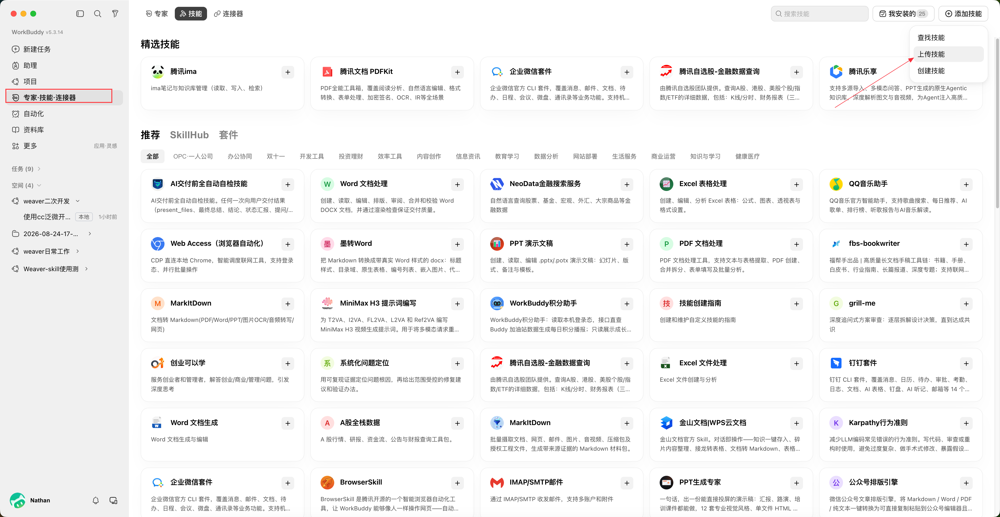
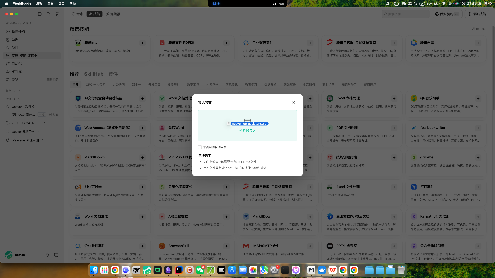
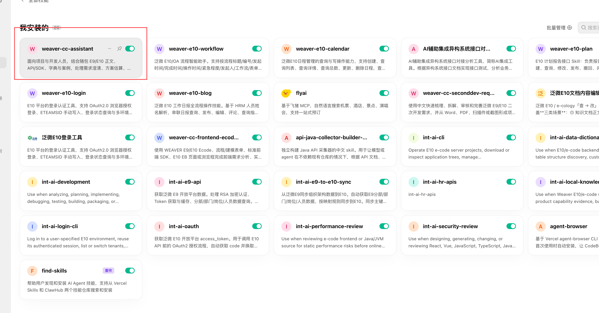

# CC Weaver Secondev Forge

项目与开发人员使用手册

编制：CC　｜　v0.3.0-rc.3 内部验证候选版　｜　2026 年 10 月 30 日

## 一、产品概述

### 1.1 适用对象

项目经理、顾问及实施人员：梳理需求、识别业务规则缺口、比较实现方案、初评工作量，并形成开发沟通和验收材料。

开发及技术负责人：查询平台资料、理解现有工程、分析故障、开展代码评审，并在指定范围内实现、检查和说明变更。

### 1.2 核心能力

需求与方案：区分标准配置、低代码和二次开发方向，整理前提、依赖、风险与分项工作量。

知识查询：按任务检索随包 E9/E10 文档、API/SDK、表字段字典及案例，并读取相关正文作为依据。

开发与排障：结合现场代码和配置分析问题，支持 E9/E10 局部实现，以及具备运行条件时的 E10 工程检查、编译与打包。

专业支持：按需调用集成、静态安全与性能评审、环境与工程、页面制作等内部模块；涉及实际操作时以本次授权范围为准。

### 1.3 使用方式

安装并启用 → 新建对话确认资料读取 → 提供任务与材料 → 复核结果并推进下一步。WorkBuddy、Codex、DSH 共用指定版本的完整仓库 ZIP，安装入口按工具能力选择。登录已获授权的 GitHub 或 Gitee 私有仓库，在发行页选择对应版本并下载源码 ZIP。不要只下载 SKILL.md，也不要下载其他仓库或旧多层目录结构的归档。

本助手不替代业务确认、技术审核或客户验收。通用资料与现场版本不一致时，应以已核实的现场接口、配置及代码为依据。

## 获取私有仓库访问权限

由维护者邀请所用平台的账号，同事接受后登录该账号，才能查看和下载。无需同时加入两个平台。

- **Gitee**：维护者在仓库成员管理中邀请用户，并为仅下载使用者选择“观察者”；接受邀请后，从发行页下载对应版本。成员管理入口：`https://gitee.com/hou_nachuan/cc-weaver-secondev-forge/team`。
- **GitHub**：维护者通过 Settings → Collaborators → Add people 邀请账号或邮箱。当前个人私有仓库的协作者包含写权限；如果需要仅授予读取权限，应另行采用组织仓库角色，不能把个人协作者当作只读用户。
- 如果不希望同事注册代码托管账号，维护者可下载指定版本 ZIP 后通过单位内部文件渠道分发；私有仓库链接不能直接变成匿名下载链接。

依据：[Gitee 成员权限](https://gitee.com/opensource-guide/git-tutorial/commands/git-repo-management.html)、[GitHub 邀请方法](https://docs.github.com/en/repositories/managing-your-repositorys-settings-and-features/repository-access-and-collaboration/inviting-collaborators-to-a-personal-repository)、[GitHub 个人仓库权限](https://docs.github.com/en/repositories/managing-your-repositorys-settings-and-features/repository-access-and-collaboration/permission-levels-for-a-personal-account-repository)。

## 二、安装与启用

准备文件：从发行页下载的版本 ZIP。WorkBuddy 使用原生上传入口，无需预先解压、运行 CMD 或逐个安装内部模块。以下截图来自 WorkBuddy 5.3.14（macOS）；其他版本或 Windows 的界面名称以实际显示为准。

### 2.1 进入技能上传入口

打开左侧“专家·技能·连接器”，进入顶部“技能”页签，点击右上角“添加技能”，选择“上传技能”。

### 2.2 导入技能压缩包

将 从发行页下载的版本 ZIP 拖入导入区域，或通过界面选择该文件，按提示完成导入。此处选择整个 ZIP，不选择内部子目录或单独的 SKILL.md。

### 2.3 确认安装并启用

进入“我安装的”，查找 weaver-cc-assistant，确认卡片右上角的开关处于启用状态。截图已显示该技能安装并启用；是否能在新会话读取资料，继续按下一步确认。

### 2.4 新建对话，确认资料读取

新建对话，选择该技能或在消息中明确写出“请使用 CC Weaver Secondev Forge”，发送以下指令。正常结果应包含实际读取的资料名称、与问题相关的依据及待确认事项，而不只是复述技能介绍。

> 请使用 CC Weaver Secondev Forge。E9 流程表单已有明细在首次打开时不汇总，新增一行后才正常。请读取相关随包资料，说明分析方向，并列出实际读取的资料及依据。本次只做分析，不修改代码。

### 2.5 Codex 安装

第 1 步：将同一个 从发行页下载的版本 ZIP 保存到本机，打开能够访问本地文件的 Codex 对话，粘贴 ZIP 的完整路径，并发送下方指令。无需自行解压或执行命令。

> 请在 Codex 中安装 CC Weaver Secondev Forge。ZIP 完整路径：【替换为本机文件路径】。请先定位归档第一层目录中的 SKILL.md，读取包内安装说明，核实当前 Codex 的用户级技能目录，展示安装位置，经我确认后完整安装。不要修改客户项目；如已有同名技能，先说明处理方案。完成后告诉我如何在新对话调用。

第 2 步：核对 AI 给出的安装位置和变更范围，确认后等待安装完成。如出现文件访问或写入权限提示，按本次安装范围确认。

第 3 步：新建对话，发送“请使用 CC Weaver Secondev Forge”，再按 2.4 节试读资料。若未识别，刷新或重启 Codex 后重试。CLI 或 IDE 扩展也可通过 /skills 查找，或以 $weaver-cc-assistant 显式调用。

### 2.6 DSH 安装

第 1 步：将同一 ZIP 保存到本机，在已经正常运行、能够读写本地文件的 DSH 对话中提供完整路径，并发送下方指令。无需寻找与 WorkBuddy 相同的上传按钮。

> 请在 DSH 中安装 CC Weaver Secondev Forge。ZIP 完整路径：【替换为本机文件路径】。请先定位归档第一层目录中的 SKILL.md，读取包内安装说明，核实当前 DSH 已启用的技能目录和本地技能支持，展示安装位置，经我确认后完整安装。不要修改客户项目或全局配置；如已有同名技能，先说明处理方案。

第 2 步：确认安装位置后，由 AI 完成解压和完整安装。若当前 DSH 未启用本地技能支持，应先由工具维护人员确认，不直接修改配置。

第 3 步：新建 DSH 对话，发送“请使用 CC Weaver Secondev Forge”，再按 2.4 节试读资料。实际读取正文并给出依据后，再开始正式任务。

Windows 与 macOS 均使用同一 ZIP 和上述流程，只需提供本机实际路径；安装目录由当前工具核实，不照搬他人的路径。

## 三、项目人员使用流程

### 3.1 提供业务材料与本次目标

至少说明系统版本、业务场景、当前做法、期望结果和本次需要的成果。可提供需求 Word、PDF、流程图或截图；附件读取取决于当前 AI 工具能力，无法识别时补充可复制文字。未知信息直接标明“待确认”。

### 3.2 先形成需求清单，再讨论实现方向

要求助手按业务流程梳理使用角色、输入与输出、关键规则、异常分支及验收点。先确认“要实现什么”，再比较标准配置、低代码和二开方向，避免把尚未确认的规则直接作为开发依据。

### 3.3 复核方案与工作量

方案应说明适用条件、所需接口和数据、依赖以及未包含事项；工时应按开发、联调、测试及上线准备等环节拆分。由开发负责人核实实现路径，项目负责人确认范围与资源后形成项目计划。

### 3.4 将已确认结论交接给开发人员

交接材料包括需求范围、业务规则、接口或字段资料、待确认项和验收标准。对未解决的问题注明确认责任人，不把 AI 的建议直接视为客户已确认的需求。

### 项目任务通用指令

> 请使用 CC Weaver Secondev Forge。系统：【E9/E10】；业务场景：【说明】；当前做法：【说明】；期望结果：【说明】；本次需要：【需求梳理/方案比较/工时初评/验收要点】。相关材料已提供。请先整理事实与待确认项，再给出建议；本次不修改代码或系统。

## 四、开发人员使用流程

### 4.1 明确工程、现场信息与操作范围

提供系统版本、实际工程或模块、当前实现、相关配置、接口和字段约定。排障任务还需复现步骤、发生时点、日志与预期结果。明确本次是只读分析、代码评审，还是允许修改指定文件。

### 4.2 先核实依据，再确定实现方案

要求助手结合随包资料与现场实现核实调用方式、版本差异和关键约束。对缺少证据的接口、字段及返回结构列为待确认项；知识库中的通用示例不能直接替代客户现场约定。

### 4.3 在批准范围内完成最小改动

目标明确且已授权的小范围修改，直接核对现有实现、完成最小改动并验证，无需重复编写方案。复杂任务先核实关键接口与业务规则。助手会沿用已确认材料，只询问影响当前工作的缺口；联调账号或部署窗口缺失，不阻塞无关的本地工作。

### 4.4 核对验证结果与交付材料

核对改动、必要配置及实际验证，区分本地检查、模拟与客户现场结果。一般修改只需简短说明；需要正式交付时，提出“根据本次已完成内容生成开发交付 HTML”，助手将按需使用随包模板和校验器。

### 开发任务通用指令

> 请使用 CC Weaver Secondev Forge。系统与版本：【说明】；目标工程/模块：【说明】；需求或问题：【说明】；现场材料：【说明】；本次范围：【只读分析/评审/允许修改的范围】；验收标准：【说明】。请先核实相关资料与现有实现，再处理任务。完成后列出变更、实际验证和待确认事项。

## 五、项目应用示例

### 示例 1：将业务描述整理为可确认的需求

使用场景：需求主要来自口头沟通，业务规则和异常处理尚未完整。输入材料：现有流程、参与角色、期望结果及特殊情况。

> 请使用 CC Weaver Secondev Forge。现有 E10 费用申请需按部门审批，超预算增加额外审批，退回后允许修改并重新提交。请梳理流程、角色、规则与异常分支，区分可能的标准配置和二开点，列出需要客户确认的问题及验收要点。本次只做需求分析。

预期成果：业务步骤、角色与数据范围、待确认规则、候选实现方向及验收清单。重点复核：预算口径、额外审批人、修改权限和重新提交规则是否明确。下一步：由项目人员组织业务确认，再形成开发范围。

### 示例 2：比较方案并初评工作量

使用场景：需求已基本明确，需要评估实施路径和资源。输入材料：已确认需求、现有能力、外部接口说明、期限和限制条件。

> 请使用 CC Weaver Secondev Forge。基于我提供的 E9 需求与接口说明，比较标准配置、轻量二开和独立接口集成的可行性。请说明各方案的适用条件、依赖和限制，并按开发、联调、测试、上线准备拆分工作量，列出估算前提及不包含事项。本次不修改系统。

预期成果：方案比较、推荐条件、分项工作量及关键依赖。重点复核：接口可用性、数据量、异常处理及测试工作是否纳入。下一步：技术负责人核实后，由项目负责人确认资源和计划；AI 初评不直接作为报价或交付承诺。

## 六、开发应用示例

### 示例 3：分析表单汇总异常

使用场景：首次打开与后续操作的表现不同，需要先定位原因。输入材料：现场版本、复现步骤、实际代码、配置和日志。

> 请使用 CC Weaver Secondev Forge。E9 表单已有明细首次打开时合计不更新，新增一行后正常。请结合所附代码和日志，检索相关随包资料，梳理初始化时机、事件触发及可能原因，区分证据与推测，并给出最小验证步骤。本次只读分析，不修改文件。

预期成果：有依据的原因分析、待核实的配置或生命周期、最小复现与验证顺序。重点复核：是否分别检查初始已有行、后续新增行和重复事件绑定。下一步：补充证据、确认原因后，再授权修改。

### 示例 4：完成已确认的局部开发

使用场景：需求和关键接口、字段约定已确认。输入材料：指定工程与模块、相关接口、现有相似实现及验收标准。

> 请使用 CC Weaver Secondev Forge。在我指定的 E10 本地工程和模块内实现已确认需求。先核对现场 API、字段约定及现有编码方式，提出最小改动方案。本次允许修改该模块，不修改其他模块、不调用生产接口、不部署。完成后列出变更文件、配置要求、实际执行的检查及待现场验证事项。

预期成果：限定范围内的实现、必要配置说明、本地检查记录及现场验收清单。重点复核：是否采用已确认接口、是否影响现有逻辑、测试范围是否与结论一致。下一步：审核改动，在测试环境进行功能与业务验证。

### 成果复核要点

确认输出回答了本次目标；事实、建议与待确认项清晰区分；结论有实际读取的资料或现场证据支撑；实现与授权范围一致；已执行检查和未验证事项分别说明。未完成现场验证的内容不得表述为已验收。

截图记录的是旧版 ZIP 文件名，操作入口保持参考价值。当前仓库 ZIP 的外层目录可能包含仓库名和版本号；安装标识仍为 `weaver-cc-assistant`。本次仅核对官方导入要求与归档结构，当前版本 ZIP 的 WorkBuddy 实际导入仍待验证。

WorkBuddy 官方依据：[技能导入](https://www.codebuddy.cn/docs/workbuddy/From-Beginner-to-Expert-Guide/Function-Description/Skills-Market)、[技能结构](https://open.workbuddy.cn/docs/skill)。
